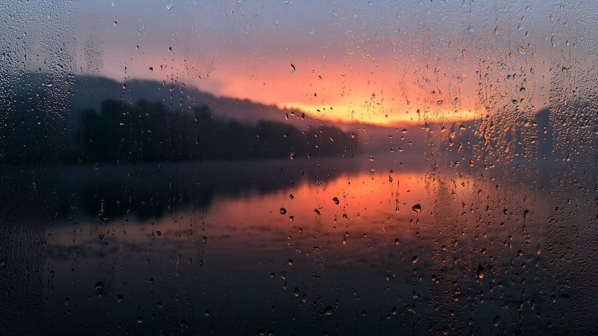
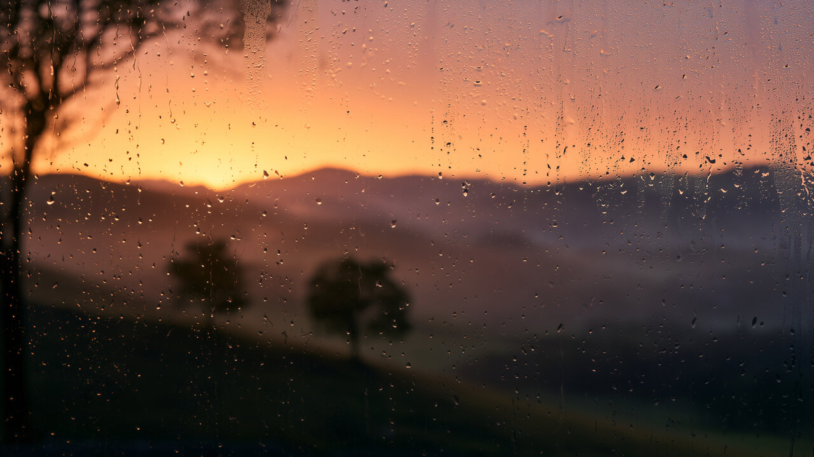

# Misty Sunset

The last glow of a sunset through a rain-misted window, with dusky plum surfaces, amber accents and a coordinated dark interface.


## Install

For **Omarchy 4 with Omarchy Shell**:

```sh
omarchy theme install https://github.com/erikrjohansson/omarchy-misty-sunset-theme
```

## Update

To get new wallpapers and fixes, update your installed themes, then apply Misty Sunset again so Omarchy picks up the new files:

```sh
omarchy theme update
omarchy theme set misty-sunset
```

## Remove

Switch to another theme first (for example with `omarchy theme switcher`), then remove Misty Sunset:

```sh
omarchy theme remove misty-sunset
```

## The theme

- The afterglow just after sunset seen through a wet window, with coral light over misty hills and water.
- A top bar in the same dusky plum as the windows.
- Plum-charcoal surfaces, amber accents, warm cream text, coral-rose for errors and lilac from the evening mist.
- Translucent menus and shell panels, coordinated terminal and editor colors, GTK 3 / GTK 4 styling, and Yaru icons with amber folders.

## Wallpapers

Two 6K (6016 × 3384) wallpapers: lake (default) and afterglow. Switch between them with `omarchy theme bg next`, or from the Omarchy menu under Style → Background.

<table>
  <tr>
    <td width="50%"></td>
    <td width="50%"></td>
  </tr>
  <tr>
    <td align="center">Lake</td>
    <td align="center">Afterglow</td>
  </tr>
</table>

## Misted Glass collection

[Misty Sunset](https://github.com/erikrjohansson/omarchy-misty-sunset-theme) · [Blue Hour](https://github.com/erikrjohansson/omarchy-blue-hour-theme) · [Cool Dawn](https://github.com/erikrjohansson/omarchy-cool-dawn-theme)

## License

[MIT](LICENSE)
